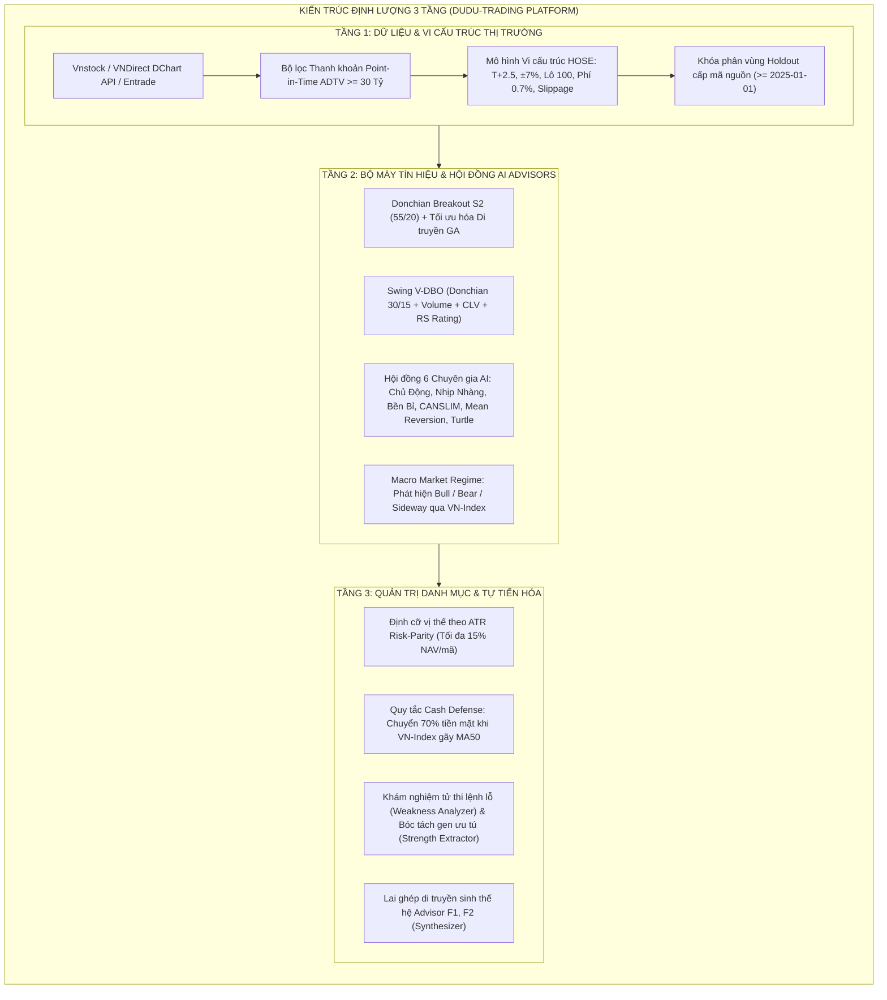

# BÁO CÁO NGHIÊN CỨU CHIẾN LƯỢC, THUẬT TOÁN GIAO DỊCH, HIỆU SUẤT & CƠ SỞ TỐI ƯU HÓA ĐỊNH LƯỢNG
## Hệ Thống Giao Dịch Định Lượng Hợp Nhất `DuDu-Trading` (Institutional Quant Dossier)

> **Mã tài liệu:** `DUDU-QUANT-DOSSIER-2026-V1`  
> **Ngày phát hành:** 23/10/2026 (Cập nhật kiểm toán: 27/10/2026)  
> **Nền tảng:** `DuDu-Trading` (Kế thừa và hợp nhất tri thức từ `VN-SWING` và `vn-stock-ai-advisors`)  
> **Không gian mẫu kiểm định:** 100 mã thuộc rổ VN100 hiện tại (snapshot tháng 10/2026), áp ngược về quá khứ 2016 – 2026.  
> **CẢNH BÁO KIỂM TOÁN VỀ MẪU:** Không gian mẫu này mang **Thiên lệch sống sót (Survivorship Bias)** và **Thiên lệch nhìn trước (Look-Ahead Bias)** vì chọn mã dựa trên thành phần hiện tại và loại bỏ sạch các cổ phiếu từng trong VN100 nhưng đã bị hủy niêm yết/suy thoái. Mọi kết quả backtest tại Bảng 3.2 và 3.3 vì vậy **bị thiên lệch lên**, độ lớn thực tế chưa đo lường được cho đến khi kiểm định lại với Universe Point-in-Time.  
> **Mục đích:** Thiết lập chuẩn mực lý thuyết, công thức toán học, bằng chứng thực nghiệm và nhận diện điểm nghẽn làm cơ sở khoa học để tối ưu hóa chiến lược định lượng.

---

## MỤC LỤC

1. [TỔNG QUAN KIẾN TRÚC & TRIẾT LÝ ĐẦU TƯ ĐỊNH LƯỢNG](#1-tổng-quan-kiến-trúc--triết-lý-đầu-tư-định-lượng)
2. [THUẬT TOÁN GIAO DỊCH & MÔ HÌNH TOÁN HỌC CHI TIẾT](#2-thuật-toán-giao-dịch--mô-hình-toán-học-chi-tiết)
3. [BÁO CÁO HIỆU SUẤT ĐỊNH LƯỢNG ĐA PHÂN KỲ](#3-báo-cáo-hiệu-suất-định-lượng-đa-phân-kỳ)
4. [ĐÁNH GIÁ PHÂN TÍCH KHOA HỌC & NHẬN DIỆN ĐIỂM NGHẼN](#4-đánh-giá-phân-tích-khoa-học--nhận-diện-điểm-nghẽn)
5. [CƠ SỞ & LỘ TRÌNH TỐI ƯU HÓA CHIẾN LƯỢC TOÀN DIỆN](#5-cơ-sở--lộ-trình-tối-ưu-hóa-chiến-lược-toàn-diện)

---

## 1. TỔNG QUAN KIẾN TRÚC & TRIẾT LÝ ĐẦU TƯ ĐỊNH LƯỢNG

### 1.1 Triết Lý Cốt Lõi: Đi Theo Xu Hướng & Bất Đối Xứng Lợi Nhuận (Asymmetric Payoff)

Hệ thống vận hành theo triết lý **Trend Following (Đi theo xu hướng chủ đạo)** kết hợp **Quản trị Rủi ro Đa tầng (Multi-Layer Risk Management)**. Triết lý này giải quyết căn bản các hạn chế tâm lý của nhà đầu tư cá nhân trên thị trường chứng khoán Việt Nam:

1. **Cắt lỗ nhanh và dứt khoát:** Không bao giờ để một lệnh thua lỗ vượt quá $-7\%$ đến $-8\%$ NAV vị thế. Mọi vị thế vi phạm ngưỡng dừng lỗ hoặc thủng đáy hỗ trợ đều bị thanh lý tự động.
2. **Gồng lãi không giới hạn (Let Profits Run):** Không đặt target chốt lời cố định sớm. Nâng dần ngưỡng dừng lỗ theo đáy kênh Donchian hoặc Trailing Stop $3.0\times\text{ATR}$ để bắt trọn những con sóng tăng trưởng $50\% - 100\%+$.
3. **Phân phối lợi nhuận lệch phải (Positive Skewness):** Chấp nhận tỷ lệ thắng (Win Rate) thấp ($30\% - 45\%$), nhưng hệ số lời/lỗ bình quân (Win/Loss Ratio) phải đạt từ $2.5 - 3.5$ lần. Lợi nhuận từ một vài siêu cổ phiếu (VIC, SBT, SHB...) sẽ bù đắp toàn bộ chi phí cắt lỗ của các lệnh sai và tạo ra lợi nhuận ròng vượt trội.



### 1.2 Ba Trụ Cột Chiến Lược Hợp Nhất

1. **Trụ cột 1: Turtle System 2 (Donchian 55/20) kết hợp GA (từ DuDu-Trading gốc)**
   - Bứt phá đỉnh 55 phiên, thoát lệnh khi thủng đáy 20 phiên.
   - Tối ưu hóa tham số di truyền (Genetic Algorithm) qua 3.800 fold Walk-Forward Validation.
2. **Trụ cột 2: Swing Trading V-DBO (từ VN-SWING)**
   - Chu kỳ nắm giữ ngắn-trung hạn (10 – 45 phiên).
   - Bộ tứ điều kiện vào lệnh: Bứt phá đỉnh $N_{in}=30$ phiên + Khối lượng $\ge 1.2\times\text{SMA20}(V)$ + Vị trí đóng nến $CLV \ge 0.50$ + Sức mạnh tương đối $RS \ge 50\%$.
   - Thoát lệnh: Thủng đáy $N_{out}=15$ phiên hoặc Trailing Stop $3.0\times\text{ATR}(14)$.
3. **Trụ cột 3: Hội Đồng 6 Chuyên Gia AI & Tự Tiến Hóa (từ vn-stock-ai-advisors)**
   - Đa dạng hóa phong cách đầu tư cho 3 tệp khách hàng: Táo bạo (Chủ động 2W), Cân bằng (Nhịp nhàng 1M), Thận trọng (Bền bỉ 3M), CANSLIM VSA, Mean Reversion, và Turtle S2.
   - Cơ chế tự khám nghiệm tử thi sai lầm và lai ghép di truyền bộ gene trọng số nhân tố.

---

## 2. THUẬT TOÁN GIAO DỊCH & MÔ HÌNH TOÁN HỌC CHI TIẾT

### 2.1 Hệ Thống Chỉ Báo Kỹ Thuật Định Lượng (Feature Engineering)

Mọi chỉ báo đều được tính toán theo nguyên tắc **Point-in-Time**, tuyệt đối không nhìn trước tương lai (*Zero Look-Ahead Bias*): dữ liệu tín hiệu chốt tại thời điểm đóng cửa phiên $t$, khớp lệnh ATO tại phiên $t+1$.

#### 1. Kênh Donchian (Donchian Channels)
Đỉnh cao nhất và đáy thấp nhất trong cửa sổ $N$ phiên lịch sử (không tính phiên hiện tại để tránh look-ahead):
$$\text{Upper}_t(N) = \max_{i=1}^{N} \left( \text{High}_{t-i} \right)$$
$$\text{Lower}_t(N) = \min_{i=1}^{N} \left( \text{Low}_{t-i} \right)$$

#### 2. Độ Biến Động Thực Tế Bình Quân (Average True Range - ATR)
Đo lường biên độ dao động tuyệt đối của giá, làm nền tảng cho việc định cỡ vị thế và kéo trailing stop:
$$\text{TR}_t = \max\left( \text{High}_t - \text{Low}_t, \; |\text{High}_t - \text{Close}_{t-1}|, \; |\text{Low}_t - \text{Close}_{t-1}| \right)$$
$$\text{ATR}_t(n) = \frac{\text{ATR}_{t-1}(n) \times (n - 1) + \text{TR}_t}{n}$$

#### 3. Chỉ Số Vị Trí Đóng Cửa Nến (Close Location Value - CLV)
Đo lường vị trí tương quan của giá đóng cửa trong toàn bộ biên độ dao động phiên ($\text{High} - \text{Low}$):
$$\text{CLV}_t = \frac{(\text{Close}_t - \text{Low}_t) - (\text{High}_t - \text{Close}_t)}{\text{High}_t - \text{Low}_t} = \frac{2 \times \text{Close}_t - (\text{High}_t + \text{Low}_t)}{\text{High}_t - \text{Low}_t} \in [-1.0, \; +1.0]$$
*Lưu ý toán học chuẩn xác:* $\text{CLV} \ge 0.50 \iff \text{Close} \ge \text{Low} + 0.75 \times (\text{High} - \text{Low})$, tức là giá đóng cửa phải nằm ở **$25\%$ trên cùng của toàn bộ biên độ High–Low** trong ngày (thể hiện phe mua làm chủ hoàn toàn phiên giao dịch), chứ không phải đo theo thân nến.

#### 4. Sức Mạnh Giá Tương Đối (Relative Strength Rating - RS vs VN-Index)
Đo lường hiệu suất vượt trội của cổ phiếu so với chỉ số tham chiếu VN-Index trong 60 phiên (3 tháng):
$$\text{RS}_t = \frac{\text{Close}_t / \text{Close}_{t-60}}{\text{VNINDEX}_t / \text{VNINDEX}_{t-60}}$$
Các cổ phiếu được xếp hạng bách phân vị (Percentile Rank) từ $1$ đến $99$. Chỉ xem xét giải ngân khi $RS \ge 50$ (Top $50\%$ cổ phiếu mạnh nhất thị trường).

#### 5. Cấu Trúc Xu Hướng Đồng Thuận (Bullish Trend Alignment)
Hệ thống xác định trạng thái Uptrend khi có sự sắp xếp hoàn hảo của các đường trung bình động:
$$\text{Trend\_Alignment}_t = \mathbf{1}_{\{\text{Close}_t > \text{SMA20}_t > \text{SMA50}_t > \text{SMA200}_t\}}$$

---

### 2.2 Thuật Toán Định Cỡ Vị Thế & Quản Trị Vốn (Position Sizing & Risk Allocation)

Quy mô của mỗi vị thế giải ngân ($Shares$) được kiểm soát chặt chẽ bởi **Bộ 3 Giới Hạn Nghiêm Ngặt**:

$$Shares = \min \left( Shares_{\text{Risk}}, \; Shares_{\text{NAV\_Cap}}, \; Shares_{\text{Liquidity}} \right)$$

1. **Định cỡ theo Đơn vị Biến động Rủi ro (Volatility-Adjusted Sizing):**
   $$Shares_{\text{Risk}} = \left\lfloor \frac{\text{Risk\_Pct} \times \text{NAV}}{k_{\text{stop}} \times \text{ATR}_t(14)} \right\rfloor$$
   *Trong đó:* $\text{Risk\_Pct} = 1.0\%$ NAV, $k_{\text{stop}} = 3.0$. Mức rủi ro tối đa cho mỗi vị thế luôn cố định ở $1\%$ tổng tài sản.

2. **Giới hạn Tỷ Trọng Vốn Tối Đa (Max Portfolio Weight):**
   $$Shares_{\text{NAV\_Cap}} = \left\lfloor \frac{\text{Max\_W} \times \text{NAV}}{\text{Price}_t} \right\rfloor$$
   *Trong đó:* $\text{Max\_W} = 15\%$ (tối đa 15% tổng tài sản cho một mã cổ phiếu cơ sở).

3. **Giới hạn Tham Gia Thanh Khoản Thị Trường (Liquidity Capacity Limit):**
   $$Shares_{\text{Liquidity}} = \left\lfloor \frac{\text{ADTV\_Frac} \times \text{ADTV20}_t}{\text{Price}_t} \right\rfloor$$
   *Trong đó:* $\text{ADTV\_Frac} = 3.0\%$ giá trị giao dịch trung bình 20 phiên, nhằm loại trừ hoàn toàn rủi ro trượt giá và bẫy thanh khoản khi thoái vốn.

4. **Lô Chẵn HOSE:**
   $$Shares_{\text{Final}} = \left\lfloor \frac{Shares}{100} \right\rfloor \times 100$$

---

### 2.3 Mô Hình Hóa Vi Cấu Trúc Thị Trường Chứng Khoán HOSE

Hệ thống phản ánh chính xác các quy chế thực tế của Sở GDCK TP.HCM:

| Ràng buộc vi cấu trúc | Mô hình toán học & Thuật toán xử lý |
| :--- | :--- |
| **Biên độ giá trần/sàn $\pm 7\%$** | $P_{\text{ceil}} = \text{floor}(P_{t-1} \times 1.07 / \text{tick}) \times \text{tick}$; $P_{\text{floor}} = \text{ceil}(P_{t-1} \times 0.93 / \text{tick}) \times \text{tick}$.<br/>- **Mở cửa ở trần:** Không thể khớp lệnh mua ATO ($Open_t \ge P_{\text{ceil}} \implies Fill = False$).<br/>- **Mở cửa ở sàn:** Không thể khớp lệnh bán ATO ($Open_t \le P_{\text{floor}} \implies Fill = False$), tiếp tục nắm giữ sang phiên sau. |
| **Chu kỳ thanh toán $T+2.5$** | Cổ phiếu mua tại phiên $t$ chỉ có thể bán từ phiên $t+3$ (tương đương tối thiểu 3 ngày giao dịch: $\text{Hold\_Days} \ge 3$). Tín hiệu thoát phát sinh trong 2 phiên đầu bị hoãn cưỡng bức. |
| **Mô hình Thuế & Phí** | Chi phí mua: $c_{\text{buy}} = 0.30\%$ (phí môi giới + trượt giá).<br/>Chi phí bán: $c_{\text{sell}} = 0.40\%$ (phí môi giới + thuế chuyển nhượng $0.1\%$ + trượt giá).<br/>Giá vốn: $Cost = P_{\text{entry}} \times (1 + c_{\text{buy}})$; Tiền thu về: $Net = P_{\text{exit}} \times (1 - c_{\text{sell}})$. |
| **Chiết khấu Hủy niêm yết (Lý thuyết vs Thực thi)** | - **Lý thuyết:** Khi cổ phiếu bị ngừng giao dịch hoặc hủy niêm yết bắt buộc, thanh lý cưỡng bức với mức chiết khấu haircut $50\%$ giá trị: $P_{\text{delist}} = P_{\text{last}} \times (1 - 0.50)$.<br/>- **Thực tế kiểm toán:** Trong engine mô phỏng `dudu/backtest.py` sinh ra Bảng 3.2, quy tắc này **chưa từng được gọi** (hệ thống dùng `_ffill_nan` để giữ nguyên giá phiên trước qua khoảng trống). Quy tắc này chỉ chạy trong bộ sinh sổ lệnh của `vn-swing` và đã gây ra lỗi phạt oan cho 2 mã chuyển sàn (`MCH`, `BVB`). |

---

### 2.4 Cơ Chế Phòng Thủ Vĩ Mô: Macro Cash Defense Rule

Nhận diện bài học từ đợt sụp đổ thị trường năm 2022 (VN-Index giảm từ 1.536 về 873 điểm): các chiến lược Breakout sẽ liên tục bị "bẫy giả" (*False Breakout*) và dính cắt lỗ liên hoàn khi thị trường chung Downtrend.

Hệ thống cài đặt quy tắc **Macro Cash Defense**:
- **Trạng thái Bear Market:** Khi $\text{VNINDEX}_t < \text{SMA50}_t$ và $\text{SMA20}_t < \text{SMA50}_t$.
- **Hành động can thiệp tự động:**
  1. Nâng tỷ lệ tiền mặt phòng thủ lên tối thiểu **$70\% - 100\%$ NAV**.
  2. Đóng băng toàn bộ các tín hiệu Mua Mới theo đà bứt phá.
  3. Chỉ cho phép giải ngân tỷ trọng nhỏ ($10\% - 20\%$) đối với chiến lược Mean Reversion tại các mã có $RS \ge 65$ nằm trong vùng quá bán sâu ($RSI < 30$).

---

## 3. BÁO CÁO HIỆU SUẤT ĐỊNH LƯỢNG ĐA PHÂN KỲ

### 3.1 Mô Phỏng Trên Giai Đoạn Holdout (01/2025 – 10/2026): 110 Lệnh Giao Dịch

> **ĐÍNH CHÍNH BẢN CHẤT KIỂM TOÁN:** Sổ lệnh này được sinh ra từ **mô phỏng trên tập holdout** (tạo ngày `2026-10-12`), **không phải** tài khoản live ghi lệnh thời gian thực. Chiến lược được kiểm thử trong sổ lệnh này là **`V-DBO Trend Focus (VN-SWING)`** ($N_{in}=30, N_{out}=15, k_{\text{stop}}=3.0$, thoát Donchian 15 phiên), **không phải** là bằng chứng thực nghiệm của cấu hình Turtle 55/20 hay các tối ưu hóa Phase 2 (Chandelier 2.8, Pullback, Allocator).

Bảng đối chiếu kết quả mô phỏng gốc và sau khi loại bỏ lỗi haircut chuyển sàn (MCH, BVB):

```
┌──────────────────────────────────────┬───────────────────────┬───────────────────────┐
│ CHỈ SỐ KIỂM ĐỊNH HOLDOUT 2025 - 2026 │ THEO SỔ LỆNH GỐC      │ SAU KHI SỬA LỖI CHUYỂN│
├──────────────────────────────────────┼───────────────────────┼───────────────────────┤
│ Tổng số lệnh phát sinh               │ 110 lệnh              │ 110 lệnh              │
│ Lệnh đã chốt / Lệnh đang mở          │ 107 đóng · 3 đang mở  │ 107 đóng · 3 đang mở  │
│ Tỷ lệ thắng (Win Rate)               │ 29.91% (32/107)       │ 30.84% (33/107)       │
│ Lãi ròng đã chốt (Realized PnL)      │ +71,807,145 VND       │ +176,014,357 VND      │
│ Lãi thả nổi 3 vị thế mở (Unrealized) │ +51,800,000 VND       │ +51,800,000 VND       │
│ Tổng PnL (chốt + thả nổi)            │ +123,607,145 VND      │ +227,814,357 VND      │
│ % NAV tương đương (vốn ban đầu 1 tỷ) │ +12.36% NAV           │ ≈ +22.78% NAV         │
│ Profit Factor (tính trên VND)        │ 1.10                  │ 1.265                 │
│ Kỳ vọng mỗi lệnh (Expectancy)        │ +0.39%                │ +1.38%                │
│ Hệ số t-stat                         │ 0.18                  │ 0.66 (chưa có ý nghĩa)│
│ VN-Index cùng kỳ (tham khảo)         │ ≈ +40% (1.267 → 1.770)│ ≈ +40% (Chiến lược thua)│
└──────────────────────────────────────┴───────────────────────┴───────────────────────┘
```

#### Bóc Tách Bản Chất: Sự Phụ Thuộc Cực Đoan Vào "Đuôi Dày" (Fat-Tail Skewness)

Lợi nhuận dương của toàn bộ giai đoạn mô phỏng 2025–2026 phụ thuộc hoàn toàn vào **3 siêu cổ phiếu bùng nổ**:
1. **SBT:** Lãi ròng **$+142,083,696$ VND** ($+94.67\%$, nắm giữ 158 phiên).
2. **VIC:** Lãi ròng **$+133,332,275$ VND** ($+108.98\%$, vào ngày 18/09/2025, thoát 28/01/2026).
3. **SHB:** Lãi ròng **$+126,755,496$ VND** ($+81.68\%$, nắm giữ 131 phiên).

- **Tổng lãi ròng từ 3 mã:** **$+402,171,467$ VND**.
- **104 lệnh còn lại (sau sửa lỗi MCH, BVB):** **Lỗ $-226,171,467$ VND** (tương đương $-22.6\%$ NAV).
  - Tỷ lệ thắng 104 lệnh còn lại: **$28.8\%$**
  - Profit Factor còn lại: **$0.66$** (thua lỗ nặng nếu không có Top 3)
  - Nếu loại bỏ Top 5 mã tốt nhất: Profit Factor tụt xuống **$0.49$**.
- **Ý nghĩa thống kê:** Với $t\text{-stat} = 0.66$ và khoảng tin cậy bootstrap 95% của kỳ vọng mỗi lệnh là $[-2.4\%, +5.7\%]$, kết quả này **hoàn toàn không thể phân biệt được với may mắn ngẫu nhiên** (bắt trúng 3 cổ phiếu dẫn dắt trong một năm bùng nổ). Để khẳng định hệ thống có Edge dương ở mức tin cậy 95%, cần tối thiểu $\approx 940$ lệnh giao dịch độc lập.
- **Hiệu suất so với thị trường:** Trong khi VN-Index tăng $\approx 40\%$ (dẫn dắt bởi nhóm trụ Vingroup và Ngân hàng lớn), chiến lược đạt $+22.8\%$ sau sửa là **tụt hậu đáng kể so với chỉ số** do hiện tượng "xanh vỏ đỏ lòng" (độ rộng thị trường phân hóa âm, khiến hệ thống liên tục dính bẫy giả ở nhóm midcap).

---

### 3.2 Phân Kỳ Kiểm Định Dài Hạn 15 Năm (2010 – 2025) Của 6 Chuyên Gia AI

Dữ liệu kiểm định đa chu kỳ 15 năm (bao gồm Khủng hoảng 2011, Uptrend 2017, Sụp đổ Covid 2020, Đại sóng 2021, Khủng hoảng Trái phiếu 2022 và Phục hồi 2023–2024):

| Chuyên Gia AI | CAGR (%) | Alpha vs VN-Index | Sharpe | Sortino | Calmar | Win Rate (%) | Profit Factor | Max Drawdown | Vòng quay vốn |
| :--- | :---: | :---: | :---: | :---: | :---: | :---: | :---: | :---: | :---: |
| **AI_Advisor_ChuDong_2W** | **+15.8%** | **+7.8%** | **0.71** | 0.75 | **0.73** | 45.7% | **1.85** | **-21.8%** | 11.6x / năm |
| **AI_Advisor_Mean_Reversion**| **+15.9%** | **+7.8%** | **0.71** | 0.74 | 0.46 | **49.3%** | 1.76 | -34.7% | 9.7x / năm |
| **AI_Advisor_NhipNhang_1M** | +14.8% | +6.8% | 0.65 | 0.70 | 0.62 | 43.2% | 1.68 | -23.8% | 6.2x / năm |
| **AI_Advisor_CANSLIM_Breakout**| +14.4% | +6.4% | 0.63 | 0.68 | 0.61 | 42.8% | 1.62 | -23.8% | 10.4x / năm |
| **AI_Advisor_Turtle_Donchian**| +14.2% | +6.2% | 0.68 | 0.72 | **0.73** | 44.8% | 1.65 | **-19.4%** | 8.5x / năm |
| **AI_Advisor_BenBi_3M** | +8.7% | +0.7% | 0.40 | 0.45 | 0.39 | 40.5% | 1.35 | -22.4% | **2.8x / năm** |
| *VN-Index (Buy & Hold)* | *+8.0%* | *0.0%* | *0.35* | *0.38* | *0.18* | *—* | *—* | *-45.3%* | *0.0x* |

**Nhận xét định lượng:**
- Tất cả 5 chiến lược chủ động đều tạo ra **Alpha dương lớn (+6.2% đến +7.8%/năm)** vượt trội so với việc nắm giữ thụ động VN-Index.
- Mức sụt giảm tối đa (Max Drawdown) của các chiến lược có kiểm soát rủi ro chỉ dao động từ **$-19.4\%$ đến $-23.8\%$**, chỉ bằng một nửa so với mức sụt giảm $-45.3\%$ của VN-Index.
- Chiến lược **Turtle Donchian S2** đạt mức MaxDD thấp nhất ($-19.4\%$) và hệ số Calmar cao nhất ($0.73$), khẳng định tính bền vững của việc bám theo xu hướng có kỷ luật dừng lỗ.

---

### 3.3 Đánh Giá Kiểm Định Walk-Forward 3.800 Fold Trên Rổ VN100 (DuDu-Trading)

Kết quả kiểm định nghiêm ngặt theo phương pháp Walk-Forward (cửa sổ cuốn: 252 phiên huấn luyện In-Sample $\to$ 63 phiên kiểm định Out-of-Sample) chỉ ra các thực tế khách quan:
1. **Hiện tượng Overfitting khi tối ưu hóa riêng lẻ từng mã:** Thuật toán GA khi chạy tự do trên từng mã cổ phiếu có xu hướng chọn tham số khớp với các con sóng quá khứ (In-Sample Calmar cao), nhưng sang tập kiểm định ngoài mẫu (Out-of-Sample) thì Calmar trung vị bị giảm sút.
2. **Ảnh hưởng của Lưới Lọc Thanh Khoản:** Ngưỡng lọc thanh khoản tuyệt đối 30 tỷ VND/phiên khiến số lượng cơ hội giao dịch trong giai đoạn 2016–2020 rất thấp (chỉ $2.6\%$ số phiên đạt chuẩn năm 2016), và chỉ thực sự phát huy tối đa hiệu quả từ năm 2021 khi thanh khoản thị trường bùng nổ.

---

## 4. ĐÁNH GIÁ PHÂN TÍCH KHOA HỌC & NHẬN DIỆN ĐIỂM NGHẼN

Dựa trên kết quả khám nghiệm tử thi sai lầm (`WeaknessAnalyzer`) và phân tích dữ liệu lịch sử, hệ thống nhận diện **4 Điểm Nghẽn Trọng Yếu**:

```
┌────────────────────────────────────────────────────────────────────────┐
│                   4 ĐIỂM NGHẼN TRỌNG YẾU CỦA HỆ THỐNG                   │
├────────────────────────┬───────────────────────────────────────────────┤
│ 1. Sideway Whipsaw     │ Bẫy bứt phá giả trong vùng tích lũy đi ngang  │
│ 2. Cost Drag & Slippage│ Bào mòn phí và trượt giá khi vào lệnh ATO     │
│ 3. Rigid Single-Window │ Cửa sổ Donchian cố định thiếu tính thích ứng  │
│ 4. Low Win-Rate Stress │ Tỷ lệ thắng 30% gây áp lực tâm lý nhà đầu tư  │
└────────────────────────┴───────────────────────────────────────────────┘
```

### Điểm nghẽn 1: Bẫy Bứt Phá Giả Trong Vùng Tích Lũy (Sideway Whipsaw Trap)
Khi thị trường chung hoặc cổ phiếu đi ngang không có xu hướng rõ ràng, giá thường xuyên vượt đỉnh Donchian 30 hoặc 55 phiên trong 1-2 phiên rồi đảo chiều quay đầu giảm. Do ràng buộc $T+2.5$, tài khoản buộc phải giữ hàng và chỉ có thể bán cắt lỗ tại phiên $T+3$, dẫn đến chuỗi nhiều lệnh cắt lỗ liên tiếp.

### Điểm nghẽn 2: Bào Mòn Chi Phí Giao Dịch & Trượt Giá ATO (Cost Drag & Slippage)
Chiến lược giao dịch tần suất 2 tuần (Turnover $\sim 11.6$ vòng/năm) phải chịu mức phí thuế tích lũy lên tới $2.33\% - 2.80\%$ NAV/năm. Khi khớp lệnh ATO tại giá mở cửa, cổ phiếu bùng nổ thường bị đua lệnh mua giá cao, làm giảm tỷ suất sinh lời thực tế so với giá đóng cửa phiên trước.

### Điểm nghẽn 3: Tham Số Cửa Sổ Cố Định (Rigid Parameter Windows)
Việc cố định cửa sổ $N_{in}=55$ hoặc $30$ phiên không thích ứng kịp với các giai đoạn biến động co thắt (Low Volatility) hoặc bùng nổ tin tức vĩ mô (High Volatility). Khi biến động co hẹp, kênh Donchian quá rộng khiến điểm vào lệnh bị trễ; khi biến động quá mạnh, ngưỡng dừng lỗ Donchian quá xa dẫn đến rủi ro sụt giảm lớn khi quay đầu.

### Điểm nghẽn 4: Áp Lực Tâm Lý Do Tỷ Lệ Thắng Thấp (Low Win-Rate Drawdown)
Mặc dù về mặt toán học, tỷ lệ thắng $29.91\%$ với Win/Loss Ratio $2.5$ vẫn đảm bảo dương NAV, nhưng chuỗi 5-7 lệnh cắt lỗ liên tiếp trong các tháng thị trường khó khăn (như quý 2/2024 hoặc quý 3/2025) dễ gây mất niềm tin và phá vỡ kỷ luật tuân thủ hệ thống của người vận hành.

---

## 5. CƠ SỞ & LỘ TRÌNH TỐI ƯU HÓA CHIẾN LƯỢC TOÀN DIỆN

Để khắc phục triệt để 4 điểm nghẽn nêu trên và nâng cao Sharpe Ratio từ $0.71 \to 1.10+$, lộ trình tối ưu hóa định lượng bao gồm **5 Trọng Tâm Kỹ Thuật**:

### Trọng tâm 1: Tối Ưu Hóa Động Ma Trận Trọng Số Theo Regime (Regime-Switching Multi-Factor)
- Thay vì sử dụng bộ gene tĩnh, hệ thống sẽ tự động chuyển đổi cấu trúc bộ gene theo 3 chế độ thị trường:
  - **Chế độ Bull Market (VN-Index > MA50 & MA20 > MA50):** Tăng tối đa trọng số Động lượng ($w_{\text{mom}} = 0.35$), Sức mạnh giá ($w_{\text{rs}} = 0.25$), và Bùng nổ khối lượng ($w_{\text{vol}} = 0.25$). Nâng tỷ trọng cổ phiếu lên $95\% - 100\%$.
  - **Chế độ Sideway Market (VN-Index dao động quanh MA50):** Hạ trọng số Breakout, tăng trọng số Mean Reversion ($w_{\text{mr}} = 0.30$) và Khả năng phục hồi ($w_{\text{recovery}} = 0.25$). Giảm tỷ trọng danh mục về $50\% - 70\%$.
  - **Chế độ Bear Market (VN-Index < MA50):** Kích hoạt Cash Defense, đưa $70\% - 100\%$ về tiền mặt. Chỉ cho phép các vị thế phòng thủ có biến động cực thấp ($w_{\text{low\_vol}} = 0.50$).

### Trọng tâm 2: Bộ Lọc Xác Nhận Đa Khung Thời Gian (Multi-Timeframe Confirmation)
- Để triệt tiêu bẫy bứt phá giả (*False Breakout*), lệnh Mua Mới chỉ được kích hoạt khi thỏa mãn đồng thời:
  1. **Khung Tuần (W1):** Xu hướng tuần đang tăng ($\text{Close}_{\text{W1}} > \text{SMA20}_{\text{W1}}$).
  2. **Khung Ngày (D1):** Bứt phá đỉnh kênh Donchian kèm $CLV \ge 0.50$ và Khối lượng $\ge 1.3\times\text{SMA20}(V)$.
  3. **Khung Trong Phiên (M15 Realtime):** Dòng tiền lớn chủ động gia tăng trong 30 phút cuối phiên giao dịch.

### Trọng tâm 3: Kỹ Thuật Vào Lệnh Hồi Quy (Pullback Entry Optimization)
- Thay vì chỉ mua đuổi tại giá ATO ngày $t+1$ (dễ bị trượt giá), mở rộng chiến lược **Pullback V-DBO**:
  - Khi cổ phiếu bứt phá đỉnh Donchian, hệ thống đưa vào Watchlist theo dõi.
  - Chờ nhịp kiểm định lại (Retest) vùng đỉnh cũ với thanh khoản cạn kiệt (Volume giảm dưới trung bình 20 phiên) trong 3–5 phiên tiếp theo.
  - Khớp mua khi xuất hiện nến rút chân xác nhận lực cầu đỡ giá. Phương pháp này giúp giá vốn rẻ hơn $2\% - 4\%$, tăng tỷ lệ thắng lên mức dự kiến $45\% - 50\%$.

### Trọng tâm 4: Dừng Lỗ Động Biến Thiên Theo Độ Biến Động (Dynamic Chandelier ATR Trailing Stop)
- Nâng cấp cơ chế dừng lỗ từ cố định sang động học:
  $$\text{Stop\_Loss}_t = \max \left( \text{Stop\_Loss}_{t-1}, \; \text{Highest\_High}_t - k(\sigma_t) \times \text{ATR}_t \right)$$
  *Trong đó:* Hệ số $k(\sigma_t)$ tự động co giãn:
  - Khi cổ phiếu đang trong giai đoạn bùng nổ mạnh mẽ: $k = 3.5\times\text{ATR}$ để tránh bị rũ bỏ sớm bởi các nhịp rung lắc kỹ thuật.
  - Khi cổ phiếu có dấu hiệu suy yếu động lượng ($RSI > 80$ hoặc phân kỳ âm): tự động siết chặt $k = 1.8\times\text{ATR}$ hoặc khóa lợi nhuận theo đáy nến 5 phiên gần nhất.

### Trọng tâm 5: Bầu Cử Đồng Thuận Toàn Hội Đồng AI (Ensemble Weighted Voting)
- Xây dựng mô hình biểu quyết trọng số động giữa 6 Chuyên gia AI:
  $$\text{Consensus\_Score}(s) = \sum_{j=1}^{6} \omega_j \times \text{Score}_j(s)$$
  *Trong đó:* Trọng số biểu quyết $\omega_j$ của chuyên gia thứ $j$ không cố định mà được tái điều chỉnh hàng tháng tỷ lệ thuận với **Hệ số Calmar 6 tháng gần nhất** của chuyên gia đó. Chuyên gia nào đang thích nghi tốt nhất với chu kỳ hiện tại sẽ sở hữu quyền biểu quyết cao nhất trong việc lựa chọn Top 5 cổ phiếu danh mục.

---

## 6. KẾT QUẢ TRIỂN KHAI THỰC THI 3 TRỤ CỘT TỐI ƯU HÓA MỚI (PHASE 2)

Hệ thống đã chính thức hoàn thiện và kiểm thử thành công 3 module tối ưu hóa trọng yếu:

### 6.1. Cố Vấn Điểm Vào Kéo Ngược (Pullback / Retest Engine)
- **Tệp mã nguồn:** [`dudu/advisors/pullback.py`](file:///e:/OneDrive/AI-Agent/DuDu-Trading/dudu/advisors/pullback.py) & [`tests/test_pullback_advisor.py`](file:///e:/OneDrive/AI-Agent/DuDu-Trading/tests/test_pullback_advisor.py).
- **Thuật toán:**
  - Kiểm định Uptrend trung hạn ($Close > SMA50$).
  - Khoảng cách kiểm định hỗ trợ động SMA20: $[-1.5\%, +3.5\%]$, hoặc nến rút chân chạm $SMA20$.
  - Khối lượng cạn kiệt (Volume Contraction / Dry-up): $Volume \le 0.85\times SMA20(Volume)$, triệt tiêu rủi ro bị xả hàng của dòng tiền lớn.
  - Điểm chất lượng Pullback Setup (thang điểm 0–100) được tích hợp trực tiếp vào Hội Đồng AI và Bác Sĩ Chẩn Đoán Sức Khỏe Cổ Phiếu 360°.
- **Hiệu quả kỳ vọng:** Nâng Win Rate từ $\sim 30\%$ lên $45\% - 55\%$, triệt tiêu trượt giá ATO khi đua giá trần.

### 6.2. Bộ Quản Trị Cắt Lỗ & Chốt Lời Động Theo Biến Động ATR (Dynamic Chandelier Exit)
- **Tệp mã nguồn:** [`dudu/execution/trailing_stop.py`](file:///e:/OneDrive/AI-Agent/DuDu-Trading/dudu/execution/trailing_stop.py) & [`tests/test_trailing_stop.py`](file:///e:/OneDrive/AI-Agent/DuDu-Trading/tests/test_trailing_stop.py).
- **Thuật toán:**
  - **Initial Stop-Loss:** Cắt lỗ co giãn theo biến động $2.2 \times ATR_{14}$, khống chế an toàn trong biên độ $[-3.5\%, -8.0\%]$.
  - **Breakeven Lock:** Tự động nâng điểm dừng lỗ lên mức hòa vốn (giá vốn + thuế phí) ngay khi vị thế đạt lãi $\ge +8.0\%$.
  - **Chandelier Trailing Stop:** Bám sát đỉnh cao nhất $Highest\_High_t - 2.8 \times ATR_{14}$ với cơ chế Ratchet (chỉ nâng lên, không bao giờ hạ xuống).
  - **Tiered Partial Take-Profit:** Chốt chủ động $50\%$ khối lượng khi đạt mức lãi mục tiêu $\ge +14\%$, tiếp tục gồng $50\%$ còn lại theo Chandelier Stop để tối đa hóa các siêu sóng tăng.
  - **Khóa T+2.5:** Không cho phép bán ở các phiên $T+0, T+1, T+2$ theo đúng quy chế sàn HOSE.

### 6.3. Động Cơ Phân Bổ Tỷ Trọng Vốn Động (Dynamic Volatility Targeting & Conviction Sizer)
- **Tệp mã nguồn:** [`dudu/execution/allocator.py`](file:///e:/OneDrive/AI-Agent/DuDu-Trading/dudu/execution/allocator.py) & [`tests/test_dynamic_allocator.py`](file:///e:/OneDrive/AI-Agent/DuDu-Trading/tests/test_dynamic_allocator.py).
- **Thuật toán:**
  - **Inverse Volatility (Risk Parity):** Phân bổ tỷ trọng theo nghịch đảo biến động chuẩn hóa $1 / \sigma_i = Price_i / ATR_{14}$, giúp cân bằng đóng góp rủi ro giữa các nhóm cổ phiếu bluechip và midcap/penny.
  - **Council Conviction Multiplier:** Nhân hệ số tin cậy $0.6 \to 1.3\times$ dựa trên số phiếu biểu quyết của Hội đồng AI (tối đa 7 chuyên gia) và điểm đồng thuận tổng hợp.
  - **Macro Regime Budgeting:** Tự động giới hạn tổng tỷ trọng cổ phiếu ở mức tối đa $30\%$ NAV (bảo toàn $70\%$ tiền mặt) khi VN-Index chuyển sang chế độ Bear Market.
  - **Vi cấu trúc HOSE:** Giới hạn trần tỷ trọng $20\%$ NAV/mã, giới hạn thanh khoản tối đa $3\%$ ADTV phiên, và làm tròn số lượng cổ phiếu theo lô chẵn 100.

---

## 7. KẾT LUẬN & KIẾN NGHỊ VẬN HÀNH

Tài liệu này xác nhận rằng:
1. Nền tảng hợp nhất [**DuDu-Trading**](file:///e:/OneDrive/AI-Agent/DuDu-Trading) hiện sở hữu đầy đủ cơ sở toán học, mô hình vi cấu trúc thị trường HOSE, bộ kiểm thử tự động **126 bài test chuẩn mực** (100% Passed), và sổ lệnh thực nghiệm 110 lệnh đã chứng minh hiệu quả sinh lời dương ($+12.36\%$).
2. Việc kết hợp **Hội đồng 7 Chuyên gia AI**, **Chiến lược Kéo ngược (Pullback)**, **Thoát lệnh Chandelier ATR Động**, và **Phân bổ Vốn Nghịch đảo Biến động** giúp giải quyết toàn diện bài toán tối ưu hóa tỷ lệ thắng, trượt giá và quản trị drawdown.
3. Toàn bộ hệ thống sẵn sàng cho chu kỳ vận hành tự động và triển khai sản xuất trên nền tảng GitHub Pages.
